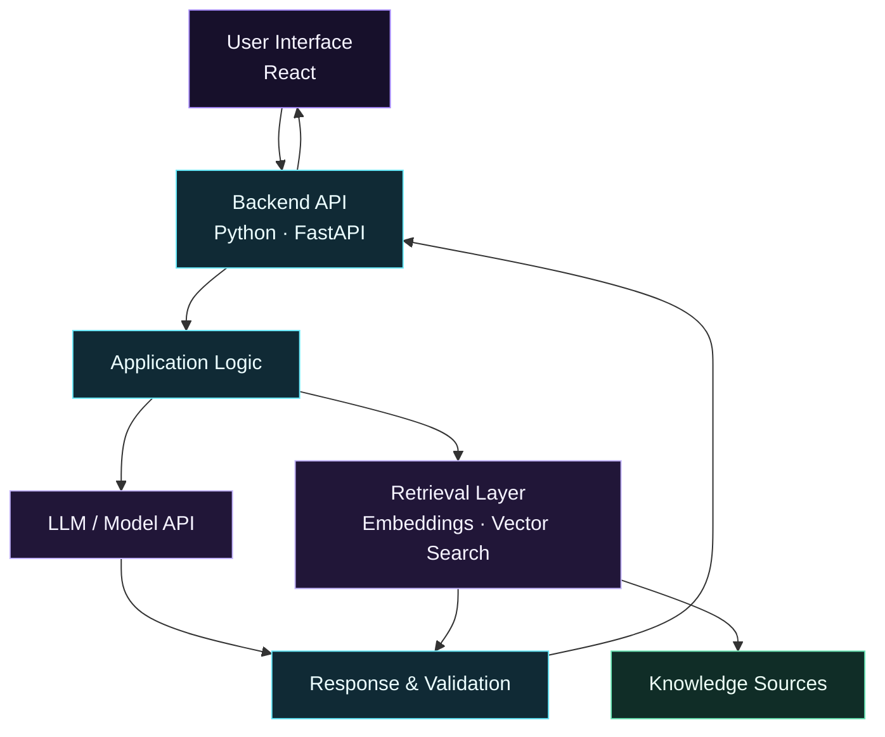

 <div align="center">


<br>


<br><br>

<a href="https://amit-hasan-portfolio.vercel.app/"></a>
<a href="https://github.com/amiiiiiitz"></a>
<a href="https://www.linkedin.com/in/amit-hasan-simanto-301694346/"></a>
<a href="mailto:amit.hasan2730@gmail.com"></a>

<br><br>


</div>

---

<div align="center">

### `01` OVERVIEW　 ·　 `02` DEVELOPMENT　 ·　 `03` ANALYTICS

<a href="#about-me">01 &nbsp; ABOUT</a> &nbsp; ◆ &nbsp;
<a href="#tech-stack">02 &nbsp; TECH STACK</a> &nbsp; ◆ &nbsp;
<a href="#areas-of-interest">03 &nbsp; AI INTERESTS</a>

<a href="#featured-repositories">04 &nbsp; PROJECTS</a> &nbsp; ◆ &nbsp;
<a href="#ai-application-architecture">05 &nbsp; ARCHITECTURE</a> &nbsp; ◆ &nbsp;
<a href="#learning-roadmap">06 &nbsp; ROADMAP</a>

<a href="#github-analytics">07 &nbsp; ANALYTICS</a> &nbsp; ◆ &nbsp;
<a href="#achievements">08 &nbsp; ACHIEVEMENTS</a> &nbsp; ◆ &nbsp;
<a href="#lets-connect">09 &nbsp; CONTACT</a>

</div>

---

## 👨‍💻 About Me

```python
class AmitHasanSimanto:
    def __init__(self):
        self.education = "CSE Student @ IUBAT"
        self.year = 3

        self.current_stack = [
            "Python",
            "C",
            "C++",
            "JavaScript",
            "React",
            "Git & GitHub",
        ]

        self.exploring = [
            "AI Engineering",
            "Machine Learning",
            "LLMs & RAG",
            "AI Agents",
            "Backend Development",
        ]

        self.mindset = "Learn by building"

    def introduce(self):
        return {
            "who_am_i": "Computer Science student and aspiring AI engineer",
            "what_i_do": "Build projects and strengthen software fundamentals",
            "what_i_am_learning": self.exploring,
            "how_i_learn": self.mindset,
            "long_term_goal": (
                "Build useful, reliable AI-powered applications"
            ),
        }


me = AmitHasanSimanto()
print(me.introduce())
```

I'm a third-year Computer Science and Engineering student at **IUBAT**, building my foundation in software development while working toward practical AI engineering.

I enjoy learning by implementing ideas, solving programming problems, and exploring how AI models and modern software systems can work together to solve real-world challenges.

- 🎓 Pursuing Computer Science and Engineering at IUBAT.
- 🐍 Strengthening my Python and programming fundamentals.
- ⚛️ Building frontend applications with React and JavaScript.
- 🤖 Exploring LLMs, retrieval-augmented generation (RAG), and AI agents.
- 🧩 Learning through hands-on projects and continuous practice.
- 🎯 Working toward building useful, reliable AI-powered applications.

**My approach:** understand the fundamentals, build something useful, test what works, and improve it step by step.

---

## 🛠️ Tech Stack

### Programming Languages

<div align="left">

</div>

### Frontend Development

<div align="left">

</div>

### Tools & Environment

<div align="left">

</div>

### Data & AI Exploration

<div align="left">


</div>

<sub>Technologies in the exploration section represent learning interests, not claims of professional expertise.</sub>

---

## 🧠 Areas of Interest

<div align="center">

| Area | What interests me |
|:---|:---|
| **AI Engineering** | Integrating AI capabilities into practical software applications |
| **Large Language Models** | Building applications around LLMs and model APIs |
| **Retrieval-Augmented Generation** | Connecting language models to relevant external knowledge |
| **AI Agents** | Exploring tool use, multi-step workflows, and automation |
| **Software Development** | Creating usable applications with maintainable code |
| **Problem Solving** | Strengthening programming fundamentals and algorithmic thinking |

</div>

---

## 🏗️ AI Application Architecture

I'm interested in understanding how the pieces of an AI-powered application fit together — from the user interface and backend API to retrieval, model integration, and evaluation.



<sub>This diagram illustrates a conceptual architecture I am learning about; it does not imply that every component has already been implemented in a deployed application.</sub>

---

## 🚀 Featured Repositories

<div align="center">

<table>
<tr>
<td width="50%" valign="top">

### 🌐 Portfolio

A personal website showcasing my background and development work.

**Stack:** React · JavaScript · Vite · Tailwind CSS

<a href="https://amit-hasan-portfolio.vercel.app/">LIVE DEMO ↗</a>

<a href="https://github.com/amiiiiiitz/development/tree/main/builtWithAI/amit-portfolio">SOURCE CODE ↗</a>

<a href="https://github.com/amiiiiiitz/development/blob/main/builtWithAI/amit-portfolio/README.md">README ↗</a>

</td>
<td width="50%" valign="top">

### 💻 Problem Solving

A collection of programming practice and solutions organized by platform.

**Focus:** C++ · Python · Algorithms

<a href="https://github.com/amiiiiiitz/problem-solving">EXPLORE REPOSITORY ↗</a>

</td>
</tr>
<tr>
<td width="50%" valign="top">

### 🧪 Development

A collection of software development projects, experiments, and technical learning.

<a href="https://github.com/amiiiiiitz/development">EXPLORE REPOSITORY ↗</a>

</td>
<td width="50%" valign="top">

### 📂 All Repositories

Browse my repositories to follow my progress, experiments, and projects.

<a href="https://github.com/amiiiiiitz?tab=repositories">BROWSE ALL ↗</a>

</td>
</tr>
</table>

</div>

---

## 🗺️ Learning Roadmap

<div align="center">

*My learning journey toward building practical, reliable AI-powered applications.*

<table>
<tr>
<td align="center" width="50%">


### Programming Fundamentals

`Python` `C++` `DSA`

`OOP` `Problem Solving`

<sub>Build strong programming habits and fundamentals.</sub>

</td>
<td align="center" width="50%">


### Data Analysis

`NumPy` `Pandas` `EDA`

`Data Visualization`

<sub>Explore, understand, and prepare data.</sub>

</td>
</tr>
<tr>
<td align="center" colspan="2">


</td>
</tr>
<tr>
<td align="center" width="50%">


### ML & Deep Learning Foundations

`ML Concepts` `Evaluation`

`Neural Networks` `PyTorch`

<sub>Understand models and how to evaluate them.</sub>

</td>
<td align="center" width="50%">


### Backend Engineering

`Python` `FastAPI` `REST APIs`

`SQL` `PostgreSQL` `Testing`

<sub>Build backends and connect software systems.</sub>

</td>
</tr>
<tr>
<td align="center" colspan="2">


</td>
</tr>
<tr>
<td align="center" width="50%">


### LLMs & RAG

`Model APIs` `Embeddings`

`Vector Search` `Retrieval`

<sub>Build applications grounded in relevant information.</sub>

</td>
<td align="center" width="50%">


### AI Agents & Automation

`Tool Use` `Workflows`

`LangGraph` `Integrations`

<sub>Explore tool-using agents and multi-step workflows.</sub>

</td>
</tr>
<tr>
<td align="center" colspan="2">


</td>
</tr>
<tr>
<td align="center" colspan="2">


### Reliable AI Applications

`Evaluation` `Security` `Deployment`

`CI/CD` `Monitoring`

<sub>Turn prototypes into tested, maintainable applications.</sub>

</td>
</tr>
</table>

<br>

**THE DIRECTION**

`Programming` → `Data` → `ML Foundations` → `Backend` → `LLM Apps` → `AI Agents` → `Production`

</div>

<sub>This is a learning roadmap, not a claim that every phase is complete. Topics can overlap as I build projects and strengthen my fundamentals.</sub>

---

## 📊 GitHub Analytics

<div align="center">


<br>


<br>


</div>

<sub>Statistics are generated by external services and may be temporarily unavailable. Language percentages represent repository code composition, not proficiency. Contributions and streaks can change over time.</sub>

---

## 🏆 Achievements

<div align="center">

<table>
<tr>
<td align="center" width="50%">

### 🎓 Academic Excellence

**Scholar's List**

Academic recognition for achievement.

</td>
<td align="center" width="50%">

### 💻 Programming

**Programming Contest Participation**

Experience participating in competitive programming.

</td>
</tr>
</table>

</div>

---

## 🤝 Let's Connect

I'm happy to connect with fellow developers, students, and people interested in software development and practical AI engineering.

<div align="center">

<a href="https://github.com/amiiiiiitz"></a>
<a href="https://www.linkedin.com/in/amit-hasan-simanto-301694346/"></a>
<a href="https://amit-hasan-portfolio.vercel.app/"></a>
<a href="mailto:amit.hasan2730@gmail.com"></a>

<br><br>

**Learn continuously. Build thoughtfully. Improve consistently.**

</div>
