**Building strong software foundations while exploring practical AI engineering.**

[Portfolio](https://amit-hasan-portfolio.vercel.app/) ·
[GitHub](https://github.com/amiiiiiitz) ·
[LinkedIn](https://www.linkedin.com/in/amit-hasan-simanto-301694346/) ·
[Email](mailto:amit.hasan2730@gmail.com)

---

[About](#about) · [Technical Stack](#technical-stack) · [Focus Areas](#areas-of-focus) ·
[Featured Work](#featured-work) · [AI Application Flow](#conceptual-ai-application-flow) ·
[Learning Roadmap](#learning-roadmap) · [GitHub Activity](#github-activity) ·
[Achievements](#achievements) · [Connect](#connect)

## About

I'm **Amit Hasan Simanto**, a third-year Computer Science and Engineering student at **IUBAT** and an aspiring AI engineer. I work with C, C++, Python, JavaScript, and React, and I'm building my software fundamentals through coursework, problem solving, and hands-on projects.

I'm especially interested in practical AI applications: learning how machine learning, language models, retrieval, and backend systems can come together to make useful software.

## Technical Stack

- **Programming and fundamentals:** C, C++, Python, JavaScript, data structures and algorithms, problem solving
- **Frontend:** React
- **Tools:** Git and GitHub
- **Currently exploring:** machine learning, NLP, LLM applications, RAG, embeddings and vector databases, AI agents, FastAPI, and workflow automation

The technologies in my learning list are areas I'm developing, not claims of expertise.

## Areas of Focus

- **AI engineering:** connecting AI capabilities to useful software
- **LLMs and NLP:** learning how to build applications around language models
- **RAG and vector search:** exploring embeddings and retrieval from external knowledge
- **AI agents and automation:** learning about tool use and multi-step workflows
- **Backend development:** building API and application foundations for AI features

## Featured Work

### Personal Portfolio

A personal website for my background, projects, and learning journey.

**Stack:** React · TypeScript · Vite · Tailwind CSS

[Live demo](https://amit-hasan-portfolio.vercel.app/) · [Source code](https://github.com/amiiiiiitz/development/tree/main/ai-assisted/learning-projects/amit-portfolio)

### [Problem Solving](https://github.com/amiiiiiitz/problem-solving)

Programming practice and solutions for Codeforces and LeetCode, using C, C++, and Python.

[Explore the repository](https://github.com/amiiiiiitz/problem-solving)

More experiments and learning projects are collected in [Development](https://github.com/amiiiiiitz/development).

## Conceptual AI Application Flow

This diagram shows an application pattern I'm learning about; it is conceptual and does not imply that each component is already implemented in a project.

## Learning Roadmap

This is a learning direction, not a list of completed skills. Topics can overlap as I build projects and strengthen my fundamentals.

## GitHub Activity

This card is generated by an external service and may occasionally be unavailable. Repository statistics are not a measure of skill.

## Achievements

- **Scholar's List** — academic recognition for achievement.
- **Programming contest participation** — experience participating in competitive programming.

## Connect

I'm glad to connect with fellow developers, students, and people interested in practical AI engineering.

[GitHub](https://github.com/amiiiiiitz) ·
[LinkedIn](https://www.linkedin.com/in/amit-hasan-simanto-301694346/) ·
[Portfolio](https://amit-hasan-portfolio.vercel.app/) ·
[Email](mailto:amit.hasan2730@gmail.com)

---

**Learn continuously. Build thoughtfully. Improve consistently.**

