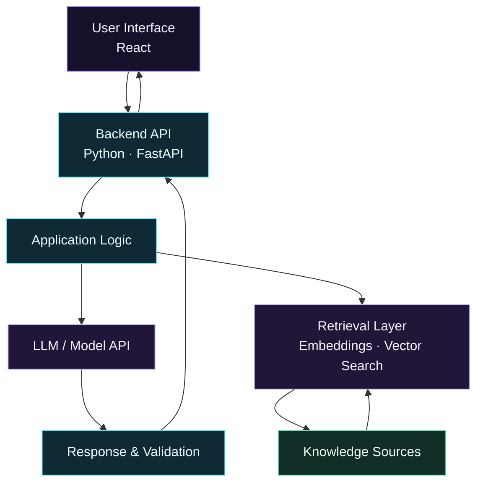

 <div align="center">


<br>


<br><br>

<a href="https://amit-hasan-portfolio.vercel.app/"></a>
<a href="https://www.linkedin.com/in/amit-hasan-simanto-301694346/"></a>
<a href="mailto:amit.hasan2730@gmail.com"></a>

<br><br>


</div>

---

## Navigation

<div align="center">

| [About](#-about-me) | [Tech Stack](#-tech-stack) | [Interests](#-areas-of-interest) | [Projects](#-featured-repositories) |
|:---:|:---:|:---:|:---:|
| [Architecture](#-how-i-think-about-ai-applications) | [Roadmap](#-learning-roadmap) | [GitHub Dashboard](#-github-analytics) | [Achievements](#-achievements) |
| [Activity](#-contribution-activity) | [Connect](#-lets-connect) | [Repositories](#-explore-my-work) | |

</div>

---

## 👨‍💻 About Me

I'm a third-year Computer Science and Engineering student at **IUBAT**, interested in building practical software and exploring how AI can solve real-world problems.

My current direction is **AI Engineering** — developing my programming foundation while learning how to integrate AI models, APIs, retrieval systems, and agent-based workflows into useful applications.

- 🎓 Pursuing Computer Science and Engineering at IUBAT.
- 🐍 Developing my Python and problem-solving skills.
- ⚛️ Building frontend applications with React and JavaScript.
- 🤖 Exploring LLMs, retrieval-augmented generation (RAG), and AI agents.
- 🧩 Learning through hands-on projects, experimentation, and continuous practice.
- 🎯 Working toward the skills needed to build reliable, practical AI-powered applications.

I believe in understanding the fundamentals, building consistently, and improving through real implementation rather than just collecting technologies.

---

## 🛠️ Tech Stack

### Languages

<div align="left">

</div>

### Frontend Development

<div align="left">

</div>

### Tools & Development Environment

<div align="left">

</div>

### Data & AI Learning

<div align="left">


</div>

<sub>Skills and learning areas are intentionally separated: tools in the learning section represent areas I am exploring, not claims of professional expertise.</sub>

---

## 🧠 Areas of Interest

<div align="center">

| Area | What interests me |
|:---|:---|
| **AI Engineering** | Integrating AI capabilities into practical software applications |
| **Large Language Models** | Building applications around LLMs and model APIs |
| **Retrieval-Augmented Generation** | Connecting language models to relevant external knowledge |
| **AI Agents** | Exploring tool use, multi-step reasoning workflows, and automation |
| **Software Development** | Creating usable applications with maintainable code |
| **Problem Solving** | Strengthening programming fundamentals and algorithmic thinking |

</div>

---

## 🏗️ How I Think About AI Applications

I'm interested in learning how the pieces of an AI-powered application fit together — from the user interface and backend API to retrieval, model integration, and evaluation.



<sub>This is a conceptual architecture I'm learning about, not a claim that every component has already been implemented in a deployed project.</sub>

---

## 🚀 Featured Repositories

These links highlight my portfolio, programming practice, and broader development work.

<div align="center">

<a href="https://github.com/amiiiiiitz/development/tree/main/builtWithAI/amit-portfolio">

</a>

<a href="https://github.com/amiiiiiitz/problem-solving">

</a>

</div>

### Selected work

| Repository | Description |
|:---|:---|
| [Portfolio](https://amit-hasan-portfolio.vercel.app/) | Personal portfolio showcasing my background and development work |
| [Development](https://github.com/amiiiiiitz/development) | A collection of software development projects and experiments |
| [Problem Solving](https://github.com/amiiiiiitz/problem-solving) | Programming practice and solutions organized by platform |

**Explore:** [Portfolio source code](https://github.com/amiiiiiitz/development/tree/main/builtWithAI/amit-portfolio) · [All repositories](https://github.com/amiiiiiitz?tab=repositories)

---

## 📊 GitHub Analytics

<div align="center">


</div>

<div align="center">


</div>

### Contribution activity

<div align="center">


</div>

<sub>These dashboards are generated from GitHub activity and repository data. Counts, language percentages, and streaks can change; language statistics reflect code in repositories, not necessarily proficiency. External chart services may occasionally be unavailable or rate-limited.</sub>

---

## 🏆 Achievements

- 🎓 **Scholar's List** — Academic recognition.
- 💻 **Programming Contest Participation** — Experience participating in competitive programming.

---

## 🗺️ Learning Roadmap

My current learning direction is focused on building strong fundamentals and gradually progressing toward practical AI engineering.

```text
Programming Fundamentals
        │
        ▼
Python · Data Structures · Problem Solving
        │
        ▼
Data Analysis · NumPy · Pandas
        │
        ▼
Machine Learning & Deep Learning Foundations
        │
        ▼
Backend Development · APIs · Databases
        │
        ▼
LLMs · Embeddings · RAG · Vector Databases
        │
        ▼
AI Agents · Tool Use · Workflow Automation
        │
        ▼
Testing · Evaluation · Deployment · Reliable AI Apps
```

The goal is to connect these skills through working projects and progressively improve code quality, testing, reliability, and deployment practices.

---

## 📈 Contribution Activity

<div align="center">


</div>

I use GitHub to document my learning, practice programming, and develop projects over time. I'm aiming to make my repositories clearer, more useful, and easier for others to explore.

---

## 🤝 Let's Connect

I'm open to connecting with fellow developers, students, and people interested in software development and practical AI engineering.

<div align="center">

<a href="https://github.com/amiiiiiitz"></a>
<a href="https://www.linkedin.com/in/amit-hasan-simanto-301694346/"></a>
<a href="https://amit-hasan-portfolio.vercel.app/"></a>
<a href="mailto:amit.hasan2730@gmail.com"></a>

<br><br>

**Learn continuously. Build thoughtfully. Improve consistently.**


</div>
