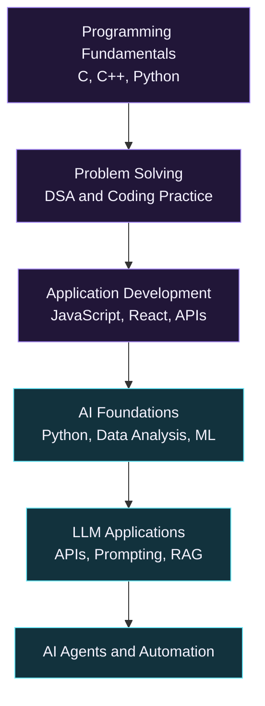

<!-- =========================================================
     AMIT HASAN SIMANTO — GITHUB PROFILE README
     Theme: Dark Violet + Cyan
     Primary: #A78BFA | Accent: #67E8F9 | Background: #0D1117
     ========================================================= -->

<div align="center">

<picture>
  <source media="(prefers-color-scheme: dark)" srcset="https://capsule-render.vercel.app/api?type=waving&height=210&color=0%3A0D1117%2C50%3A211638%2C100%3A12323D&text=Amit%20Hasan%20Simanto&fontColor=F5F3FF&fontSize=38&fontAlignY=38&desc=Aspiring%20AI%20Engineer&descSize=17&descAlignY=58&animation=fadeIn">
  
</picture>

<a href="https://readme-typing-svg.demolab.com/">
  
</a>

<br>

<a href="https://github.com/amiiiiiitz">
  
</a>
<a href="https://www.linkedin.com/in/amit-hasan-simanto-301694346/">
  
</a>
<a href="mailto:amit.hasan2730@gmail.com">
  
</a>


</div>

---

## Table of Contents

- [About Me](#-about-me)
- [Technologies and Tools](#-technologies-and-tools)
- [Areas of Interest](#-areas-of-interest)
- [Featured Repositories](#-featured-repositories)
- [My Learning Journey](#-my-learning-journey)
- [GitHub Statistics](#-github-statistics)
- [Contribution Activity](#-contribution-activity)
- [Achievements](#-achievements)
- [Connect With Me](#-connect-with-me)
- [External Services](#-external-services)

---

## 👨‍💻 About Me

```python
amit = {
    "name": "Amit Hasan Simanto",
    "education": "CSE Student at IUBAT (3rd year)",
    "career_goal": "Aspiring AI Engineer",
    "languages": ["C", "C++", "Python", "JavaScript"],
    "frontend": ["React", "HTML5", "CSS3", "Tailwind CSS"],
    "interests": [
        "Artificial Intelligence and Machine Learning",
        "Large Language Models",
        "Retrieval-Augmented Generation",
        "AI Agents",
        "Workflow Automation",
    ],
    "approach": "Learn by building and solving problems",
}
```

I'm a third-year Computer Science and Engineering student at IUBAT, developing my programming and application-building skills while exploring practical AI engineering.

I'm interested in how AI systems can be integrated into useful applications, particularly through LLMs, retrieval-augmented generation, AI agents, and automation.

My goal is to build a strong engineering foundation, create meaningful projects, and grow into an AI engineering role.

---

## ⚡ Technologies and Tools

### Programming Languages

<picture>
  <source media="(prefers-color-scheme: dark)" srcset="https://skillicons.dev/icons?i=c,cpp,python,js&theme=dark">
  
</picture>

### Frontend Development

<picture>
  <source media="(prefers-color-scheme: dark)" srcset="https://skillicons.dev/icons?i=react,vite,tailwind,html,css&theme=dark">
  
</picture>

### Data Analysis

<picture>
  <source media="(prefers-color-scheme: dark)" srcset="https://skillicons.dev/icons?i=numpy,pandas&theme=dark">
  
</picture>

### Developer Tools

<picture>
  <source media="(prefers-color-scheme: dark)" srcset="https://skillicons.dev/icons?i=git,github,vscode&theme=dark">
  
</picture>

---

## 🌱 Areas of Interest

<table>
  <tr>
    <td width="50%">
      <h3>🤖 AI Engineering</h3>
      <p>Practical AI applications, LLM integration, RAG pipelines, and AI agents.</p>
    </td>
    <td width="50%">
      <h3>⚙️ Application Development</h3>
      <p>Python, React, APIs, and connecting software components into useful products.</p>
    </td>
  </tr>
  <tr>
    <td width="50%">
      <h3>📚 Continuous Learning</h3>
      <p>Strengthening programming fundamentals, data structures, algorithms, and AI knowledge.</p>
    </td>
    <td width="50%">
      <h3>🧩 Problem Solving</h3>
      <p>Practising coding problems and improving logical thinking through implementation.</p>
    </td>
  </tr>
</table>

---

## 📌 Featured Repositories

These are selected repositories from my GitHub. Visit each repository for its current contents and progress.

<table>
  <tr>
    <td width="50%" valign="top">
      <h3>🌐 Portfolio Website</h3>
      <p>My personal portfolio website, built to present my background, projects, and achievements.</p>
      <a href="https://github.com/amiiiiiitz/development/tree/main/builtWithAI/amit-portfolio">
        
      </a>
      <a href="https://amit-hasan-portfolio.vercel.app/">
        
      </a>
    </td>
    <td width="50%" valign="top">
      <h3>💻 Problem Solving</h3>
      <p>A collection of programming problem solutions from platforms including Codeforces and LeetCode.</p>
      <a href="https://github.com/amiiiiiitz/problem-solving">
        
      </a>
    </td>
  </tr>
  <tr>
    <td width="50%" valign="top">
      <h3>🗂️ Development</h3>
      <p>A repository for my software development projects, practical experiments, and technical learning.</p>
      <a href="https://github.com/amiiiiiitz/development">
        
      </a>
    </td>
    <td width="50%" valign="top">
      <h3>🔎 Explore More</h3>
      <p>Browse my public repositories to see more of my code, experiments, and learning progress.</p>
      <a href="https://github.com/amiiiiiitz?tab=repositories">
        
      </a>
    </td>
  </tr>
</table>

---

## 🧭 My Learning Journey

My learning direction connects programming fundamentals with practical AI application development.



This diagram represents my learning direction, not a claim that every stage is complete.

---

## 📊 GitHub Statistics

<p align="center">
  <picture>
    <source media="(prefers-color-scheme: dark)" srcset="https://github-readme-stats.vercel.app/api?username=amiiiiiitz&show_icons=true&hide_border=true&bg_color=0D1117&title_color=A78BFA&text_color=E5E7EB&icon_color=67E8F9&rank_icon=github">
    
  </picture>
  <picture>
    <source media="(prefers-color-scheme: dark)" srcset="https://github-readme-stats.vercel.app/api/top-langs/?username=amiiiiiitz&layout=compact&langs_count=8&hide_border=true&bg_color=0D1117&title_color=A78BFA&text_color=E5E7EB">
    
  </picture>
</p>

<p align="center">
  <picture>
    <source media="(prefers-color-scheme: dark)" srcset="https://streak-stats.demolab.com/?user=amiiiiiitz&hide_border=true&background=0D1117&ring=A78BFA&fire=67E8F9&currStreakLabel=67E8F9&sideLabels=E5E7EB&currStreakNum=F5F3FF&sideNums=F5F3FF&dates=9CA3AF">
    
  </picture>
</p>

---

## 📈 Contribution Activity

<p align="center">
  <picture>
    <source media="(prefers-color-scheme: dark)" srcset="https://github-readme-activity-graph.vercel.app/graph?username=amiiiiiitz&bg_color=0D1117&color=E5E7EB&line=A78BFA&point=67E8F9&area=true&area_color=211638&hide_border=true&custom_title=Contribution%20Activity">
    
  </picture>
</p>

<p align="center">
  <a href="https://github.com/amiiiiiitz?tab=repositories">
    
  </a>
</p>

---

## 🏆 Achievements

- **Scholar's List:** Academic achievement certificate.
- **Programming Contests:** Participation in programming contests.

---

## 🤝 Connect With Me

<p align="center">
  <a href="https://github.com/amiiiiiitz">
    
  </a>
  <a href="https://www.linkedin.com/in/amit-hasan-simanto-301694346/">
    
  </a>
  <a href="mailto:amit.hasan2730@gmail.com">
    
  </a>
</p>

<p align="center">
  <a href="https://amit-hasan-portfolio.vercel.app/">Portfolio Website</a>
  &nbsp; • &nbsp;
  <a href="https://github.com/amiiiiiitz?tab=repositories">Repositories</a>
  &nbsp; • &nbsp;
  <a href="https://github.com/amiiiiiitz/problem-solving">Problem Solving</a>
</p>

---

## 🛠️ External Services

This profile uses the following third-party services to render dynamic images:

| Service | Purpose |
|---|---|
| [Capsule Render](https://github.com/kyechan99/capsule-render) | Animated header and banner |
| [Readme Typing SVG](https://github.com/DenverCoder1/readme-typing-svg) | Typing animation |
| [Shields.io](https://shields.io/) | Profile and social badges |
| [Komarev](https://github.com/antonkomarev/github-profile-views-counter) | Profile view counter |
| [Skill Icons](https://skillicons.dev/) | Technology icon rows |
| [GitHub Readme Stats](https://github.com/anuraghazra/github-readme-stats) | GitHub stats and language cards |
| [Streak Stats](https://github.com/DenverCoder1/github-readme-streak-stats) | Contribution streak |
| [GitHub Readme Activity Graph](https://github.com/Ashutosh00710/github-readme-activity-graph) | Contribution activity chart |
| [Mermaid](https://mermaid.js.org/) | Learning roadmap diagram |

---

<div align="center">

<picture>
  <source media="(prefers-color-scheme: dark)" srcset="https://capsule-render.vercel.app/api?type=waving&section=footer&height=120&color=0%3A12323D%2C50%3A211638%2C100%3A0D1117">
  
</picture>

### Thanks for visiting my profile!

**If you find a repository useful, consider giving it a ⭐.**

<sub>Learning consistently. Building thoughtfully. Growing one project at a time.</sub>

</div>
