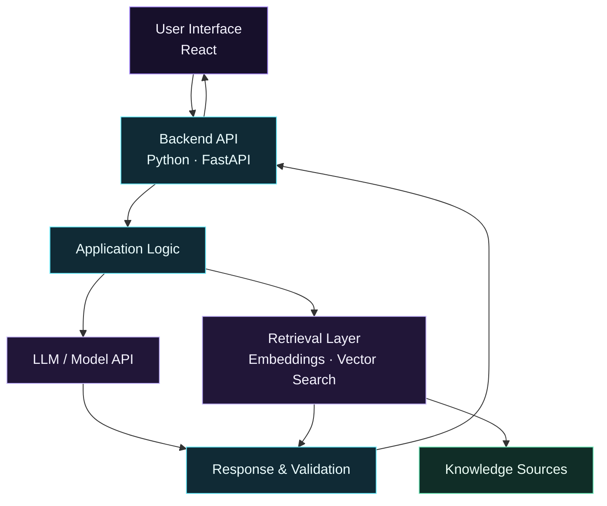

<div align="center">

[](https://amit-hasan-portfolio.vercel.app/)


<a href="https://amit-hasan-portfolio.vercel.app/"></a>
<a href="https://www.linkedin.com/in/amit-hasan-simanto-301694346/"></a>
<a href="mailto:amit.hasan2730@gmail.com"></a>


[ABOUT](#01--about-me) &nbsp;·&nbsp; [STACK](#02--tech-stack) &nbsp;·&nbsp; [INTERESTS](#03--areas-of-interest) &nbsp;·&nbsp; [ARCHITECTURE](#04--ai-application-architecture) &nbsp;·&nbsp; [PROJECTS](#05--featured-repositories) &nbsp;·&nbsp; [ROADMAP](#06--learning-roadmap) &nbsp;·&nbsp; [ANALYTICS](#07--github-observatory)

</div>

---

## 01 / ABOUT ME

[](https://amit-hasan-portfolio.vercel.app/)

I'm a third-year Computer Science and Engineering student at **IUBAT**, building my foundation in software development while working toward practical AI engineering.

I enjoy learning by implementing ideas, solving programming problems, and exploring how AI models and modern software systems can work together to solve real-world challenges.

- 🎓 Pursuing Computer Science and Engineering at IUBAT.
- 🐍 Strengthening my Python and programming fundamentals.
- ⚛️ Building frontend applications with React and JavaScript.
- 🤖 Exploring LLMs, retrieval-augmented generation (RAG), and AI agents.
- 🧩 Learning through hands-on projects and continuous practice.
- 🎯 Working toward building useful, reliable AI-powered applications.

> **LEARN BY BUILDING.** *Understand the fundamentals, build something useful, test what works, and improve it step by step.*

<details>
<summary><b>↳ Read my profile as Python code</b></summary>

```python
class AmitHasanSimanto:
    def __init__(self):
        self.education = "CSE Student @ IUBAT"
        self.year = 3

        self.current_stack = [
            "Python",
            "C",
            "C++",
            "JavaScript",
            "React",
            "Git & GitHub",
        ]

        self.exploring = [
            "AI Engineering",
            "Machine Learning",
            "LLMs & RAG",
            "AI Agents",
            "Backend Development",
        ]

        self.mindset = "Learn by building"

    def introduce(self):
        return {
            "who_am_i": "Computer Science student and aspiring AI engineer",
            "what_i_do": "Build projects and strengthen software fundamentals",
            "what_i_am_learning": self.exploring,
            "how_i_learn": self.mindset,
            "long_term_goal": "Build useful, reliable AI-powered applications",
        }


me = AmitHasanSimanto()
print(me.introduce())
```

</details>

---

## 02 / TECH STACK

<div align="center">


</div>

| Practice | Main tools |
|:---|:---|
| **Programming** | Python, C, C++, JavaScript |
| **Frontend** | React, HTML, CSS, Tailwind CSS, Vite |
| **Tools & workflow** | Git, GitHub, Visual Studio Code |
| **Exploring** | Machine learning, LLMs, RAG, AI agents, backend development |

<div align="center">


</div>

<sub>These are the technologies I use or am learning, not self-awarded proficiency scores. The exploration items are learning interests, not claims of professional expertise.</sub>

---

## 03 / AREAS OF INTEREST


| Area | What interests me |
|:---|:---|
| **AI Engineering** | Integrating AI capabilities into practical software applications |
| **Large Language Models** | Building applications around LLMs and model APIs |
| **Retrieval-Augmented Generation** | Connecting language models to relevant external knowledge |
| **AI Agents** | Exploring tool use, multi-step workflows, and automation |
| **Software Development** | Creating usable applications with maintainable code |
| **Problem Solving** | Strengthening programming fundamentals and algorithmic thinking |

---

## 04 / AI APPLICATION ARCHITECTURE

I'm interested in understanding how the pieces of an AI-powered application fit together, from the user interface and backend API to retrieval, model integration, and validation.


1. The user types a question in the **React** interface.
2. The interface sends the request to the **Python API**.
3. The API asks the **retrieval layer** to find useful facts in the knowledge sources.
4. The **LLM** (large language model) writes an answer using those facts.
5. The API checks the response and returns it to the screen.

<details>
<summary><b>↳ Prefer a text-based diagram?</b></summary>



</details>

<sub>This is a conceptual architecture I am learning about. It does not mean every component has already been built in a deployed application.</sub>

---

## 05 / FEATURED REPOSITORIES

<table width="100%">
<tr>
<td width="50%" valign="top">

<a href="https://amit-hasan-portfolio.vercel.app/"></a>

**01 / WEB**<br>
[**PORTFOLIO ↗**](https://amit-hasan-portfolio.vercel.app/)<br>
A personal website showcasing my background and development work.<br>
React · JavaScript · Vite · Tailwind CSS<br>
[Live demo ↗](https://amit-hasan-portfolio.vercel.app/) · [Source code ↗](https://github.com/amiiiiiitz/development/tree/main/builtWithAI/amit-portfolio) · [README ↗](https://github.com/amiiiiiitz/development/blob/main/builtWithAI/amit-portfolio/README.md)

</td>
<td width="50%" valign="top">

<a href="https://github.com/amiiiiiitz/problem-solving"></a>

**02 / ALGORITHMS**<br>
[**PROBLEM SOLVING ↗**](https://github.com/amiiiiiitz/problem-solving)<br>
A collection of programming practice and solutions organized by platform.<br>
C++ · Python · Algorithms

</td>
</tr>
<tr>
<td width="50%" valign="top">

<a href="https://github.com/amiiiiiitz/development"></a>

**03 / PROJECTS**<br>
[**DEVELOPMENT ↗**](https://github.com/amiiiiiitz/development)<br>
Software development projects, experiments, and technical learning.

</td>
<td width="50%" valign="top">

<a href="https://github.com/amiiiiiitz?tab=repositories"></a>

**04 / EVERYTHING**<br>
[**ALL REPOSITORIES ↗**](https://github.com/amiiiiiitz?tab=repositories)<br>
Browse my repositories to follow my progress, experiments, and projects.

</td>
</tr>
</table>

<sub>Cover images are illustrative artwork, not actual screenshots of the projects.</sub>

---

## 06 / LEARNING ROADMAP


<div align="center">

`Programming` → `Machine Learning` → `Backend` → `LLM Apps` → `AI Agents` → `Production`

</div>

<sub>This is a learning roadmap, not a claim that every phase is complete. Topics overlap as I build projects and strengthen my fundamentals.</sub>

---

## 07 / GITHUB OBSERVATORY

<div align="center">


</div>

<details>
<summary><b>↳ Expand the animated 3D contribution field</b></summary>

<div align="center">


</div>

</details>

<details>
<summary><b>↳ Expand additional GitHub analytics</b></summary>

<div align="center">


</div>

</details>

<sub>Statistics are generated by third-party services and may be cached, rate-limited, or temporarily unavailable. Language percentages reflect repository code composition, not proficiency. Private contributions may not appear.</sub>

---

## 08 / ACHIEVEMENTS

<table width="100%">
<tr>
<td align="center" width="50%">

### 🎓 Academic Excellence

**Scholar's List**

Academic recognition for achievement.

</td>
<td align="center" width="50%">

### 💻 Programming

**Programming Contest Participation**

Experience participating in competitive programming.

</td>
</tr>
</table>

---

## 09 / LET'S CONNECT

I'm happy to connect with fellow developers, students, and people interested in software development and practical AI engineering.

<div align="center">

<a href="https://github.com/amiiiiiitz"></a>
<a href="https://www.linkedin.com/in/amit-hasan-simanto-301694346/"></a>
<a href="https://amit-hasan-portfolio.vercel.app/"></a>
<a href="mailto:amit.hasan2730@gmail.com"></a>

[](https://github.com/amiiiiiitz)

<sub>AMIT HASAN SIMANTO / 2026</sub>

</div>