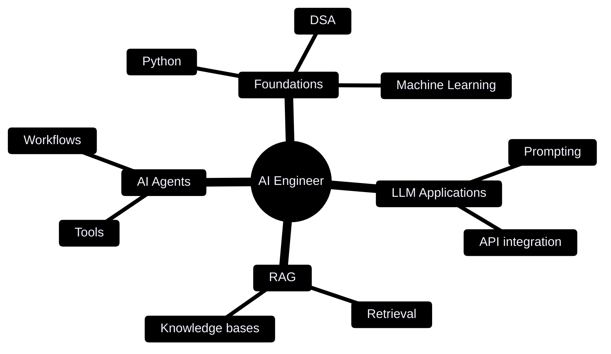
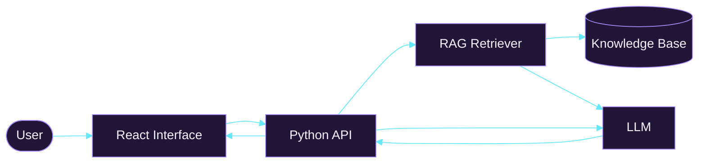
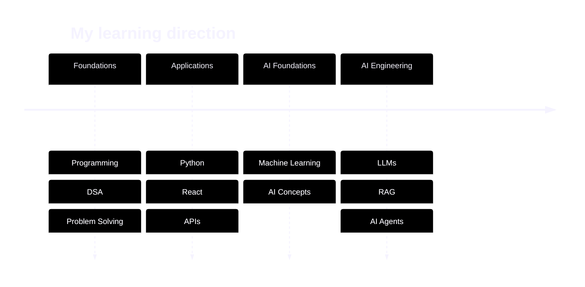

<div align="center">


<br>

<a href="https://github.com/amiiiiiitz"></a>
<a href="https://www.linkedin.com/in/amit-hasan-simanto-301694346/"></a>
<a href="mailto:amit.hasan2730@gmail.com"></a>
<a href="https://amit-hasan-portfolio.vercel.app/"></a>

<br><br>


<br><br>


<br><br>

<table>
  <tr>
    <td align="center"><a href="#about">01 · About</a></td>
    <td align="center"><a href="#stack">02 · Tech Stack</a></td>
    <td align="center"><a href="#interests">03 · Interests</a></td>
    <td align="center"><a href="#repos">04 · Repositories</a></td>
  </tr>
  <tr>
    <td align="center"><a href="#roadmap">05 · Roadmap</a></td>
    <td align="center"><a href="#activity">06 · Activity</a></td>
    <td align="center"><a href="#achievements">07 · Achievements</a></td>
    <td align="center"><a href="#connect">08 · Connect</a></td>
  </tr>
</table>


</div>

<a id="about"></a>


<br>

I'm a third-year Computer Science and Engineering student at IUBAT, developing my programming and application-building skills while exploring practical AI engineering.

I'm interested in how AI systems can be integrated into useful applications, particularly through large language models, retrieval-augmented generation, AI agents, and workflow automation.

My goal is to strengthen my engineering foundations, build meaningful projects, and grow into an AI engineering role.

```python
amit = {
    "name": "Amit Hasan Simanto",
    "education": "CSE Student at IUBAT (3rd year)",
    "career_goal": "Aspiring AI Engineer",
    "languages": ["C", "C++", "Python", "JavaScript"],
    "interests": [
        "AI and Machine Learning",
        "LLM Applications",
        "RAG",
        "AI Agents",
        "Workflow Automation",
    ],
    "approach": "Learn by building and solving problems",
}
```

<div align="center"></div>

<a id="stack"></a>


<br>

<div align="center">

<sub><b>PROGRAMMING LANGUAGES</b></sub><br><br>


<br><br>

<sub><b>FRONTEND DEVELOPMENT</b></sub><br><br>


<br><br>

<sub><b>DEVELOPER TOOLS</b></sub><br><br>


<br><br>

<sub><b>CURRENTLY EXPLORING</b></sub><br><br>


</div>

<div align="center"></div>

<a id="interests"></a>


<br>

<table width="100%">
  <tr>
    <td width="50%" valign="top">
      <h3>🧠 AI Engineering</h3>
      <p>Practical AI applications, LLM integration, RAG pipelines, and AI agents.</p>
    </td>
    <td width="50%" valign="top">
      <h3>⚙️ Application Development</h3>
      <p>Python, React, APIs, and connecting software components into useful products.</p>
    </td>
  </tr>
  <tr>
    <td width="50%" valign="top">
      <h3>📚 Continuous Learning</h3>
      <p>Programming fundamentals, data structures, algorithms, and AI knowledge.</p>
    </td>
    <td width="50%" valign="top">
      <h3>🧩 Problem Solving</h3>
      <p>Practising coding problems and improving logical thinking through implementation.</p>
    </td>
  </tr>
</table>

### The AI focus map



### The kind of AI app I'm learning to build



1. The user types a question in the **React** interface.
2. The interface sends it to the **Python API**.
3. The API asks the **RAG retriever** to find useful facts in the knowledge base.
4. The **LLM** (large language model) writes the answer using those facts.
5. The answer travels back through the API to the screen.

<div align="center"></div>

<a id="repos"></a>


<br>

<table width="100%">
  <tr>
    <td width="50%" valign="top">
      <h3>🌐 Portfolio Website</h3>
      <p>My personal portfolio presenting my background, projects, and achievements.</p>
      <a href="https://amit-hasan-portfolio.vercel.app/"></a>
      <a href="https://github.com/amiiiiiitz/development/tree/main/builtWithAI/amit-portfolio"></a>
    </td>
    <td width="50%" valign="top">
      <h3>🧩 Problem Solving</h3>
      <p>A collection of programming solutions from platforms including Codeforces and LeetCode.</p>
      <a href="https://github.com/amiiiiiitz/problem-solving"></a>
      
    </td>
  </tr>
  <tr>
    <td width="50%" valign="top">
      <h3>🛠️ Development</h3>
      <p>Software development projects, practical experiments, and technical learning.</p>
      <a href="https://github.com/amiiiiiitz/development"></a>
      
    </td>
    <td width="50%" valign="top">
      <h3>📂 More Repositories</h3>
      <p>Explore my public repositories to follow my coding practice and development journey.</p>
      <a href="https://github.com/amiiiiiitz?tab=repositories"></a>
    </td>
  </tr>
</table>

<div align="center"></div>

<a id="roadmap"></a>


<br>



<p align="center"><sub>A learning direction, not a claim that every stage is complete.</sub></p>

<div align="center"></div>

<a id="activity"></a>


<br>

<div align="center">


<br><br>


</div>

<div align="center"></div>

<a id="achievements"></a>


<br>

<table width="100%">
  <tr>
    <td width="50%" valign="top">
      <h3>🎓 Scholar's List</h3>
      <p>Academic achievement certificate.</p>
    </td>
    <td width="50%" valign="top">
      <h3>💻 Programming Contests</h3>
      <p>Programming contest participation.</p>
    </td>
  </tr>
</table>

<div align="center"></div>

<a id="connect"></a>


<br>

<div align="center">

<a href="https://github.com/amiiiiiitz"></a>
<a href="https://www.linkedin.com/in/amit-hasan-simanto-301694346/"></a>
<a href="mailto:amit.hasan2730@gmail.com"></a>

<br><br>

<a href="https://amit-hasan-portfolio.vercel.app/">Portfolio</a>
&nbsp;·&nbsp;
<a href="https://github.com/amiiiiiitz?tab=repositories">Repositories</a>
&nbsp;·&nbsp;
<a href="https://github.com/amiiiiiitz/problem-solving">Problem Solving</a>

<br><br>


### Thanks for visiting my profile.

**If you find a repository useful, consider giving it a ⭐**

<sub>Learning consistently · Building thoughtfully · Growing one project at a time</sub>

</div>
